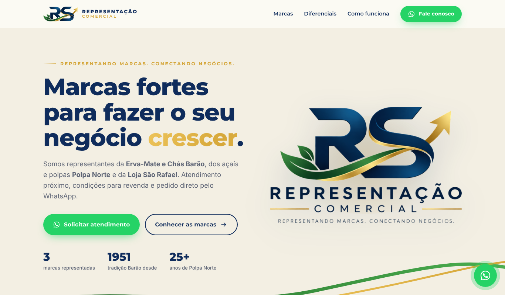
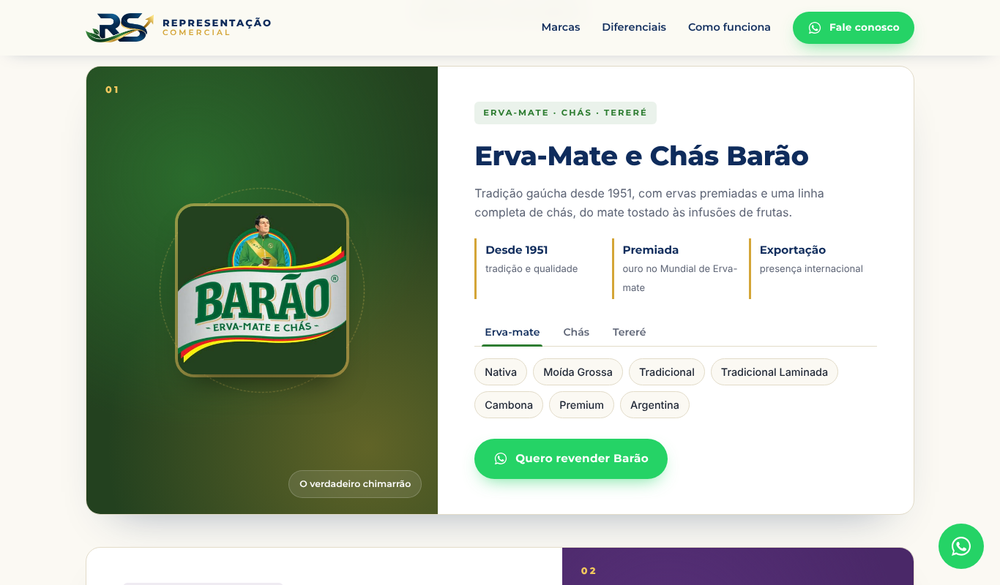
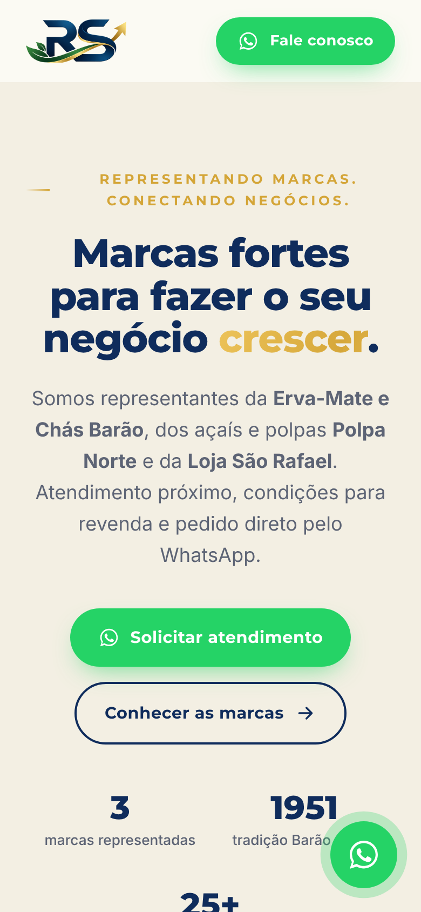

# RS Representação Comercial — Landing Page

> *Representando marcas. Conectando negócios.*

Landing page desenvolvida para a **RS Representação Comercial**, empresa que representa as marcas **Erva-Mate e Chás Barão**, **Polpa Norte** (açaís e polpas de frutas) e **Loja São Rafael** (doces, festas e food service).

O objetivo da página é captar clientes que pesquisam por qualquer uma dessas marcas e direcioná-los ao **WhatsApp** da representação, com mensagens já preenchidas de acordo com a marca ou o tipo de negócio de interesse.

 **Site no ar:** _adicione aqui o link do Cloudflare Pages_



---

##  Funcionalidades

- **Seção para cada marca**, com logo, diferenciais e produtos organizados em abas (erva-mate, chás, tereré, açaí, polpas, guloseimas, food service etc.).
- **Botões de WhatsApp com mensagem automática**: cada botão abre a conversa com um texto diferente, indicando de qual marca o cliente veio.
- **Quiz "Qual é o seu tipo de negócio?"**: o visitante escolhe o segmento (mercado, açaiteria, café, confeitaria ou consumo próprio) e recebe a indicação das marcas mais adequadas, com um botão de WhatsApp personalizado.
- **Contadores animados**, animações de entrada ao rolar a página e faixas desenhadas em SVG inspiradas no logo da empresa.
- **Botão flutuante de WhatsApp** com balão de mensagem.
- **Layout responsivo**, adaptado para celular, tablet e desktop.
- **SEO básico**: título, descrição e palavras-chave com o nome das marcas, para facilitar que a página seja encontrada em buscas.
- **Acessibilidade**: textos alternativos nas imagens e respeito à preferência do sistema por menos animações (`prefers-reduced-motion`).

<p align="center">
  
  &nbsp;
  
</p>

##  Identidade visual

A página segue a identidade visual da RS Representação Comercial:

| Cor | Uso |
|---|---|
| `#0f2c5c` Azul-marinho | Títulos, menu e seções de destaque |
| `#d4a537` Dourado | Detalhes, linhas e palavras em destaque |
| `#2e7d32` Verde | Faixas decorativas e acento da marca Barão |
| `#f3efe3` Creme | Fundo principal |

Tipografia: **Montserrat** (títulos) e **Inter** (textos), via Google Fonts.

## 🛠️ Tecnologias

- HTML5 semântico
- CSS3 (Grid, Flexbox, variáveis CSS, animações e media queries)
- JavaScript puro (sem frameworks)
- Ícones em SVG inline
- Hospedagem: Cloudflare Pages

## Estrutura

```
rs-landing/
├── index.html            # Página completa (HTML, CSS e JS)
├── logo.png              # Logo completo da RS
├── logo-rs.png           # Monograma da RS (menu e favicon)
├── logo-barao.jpg        # Logo Barão Erva-Mate e Chás
├── logo-polpanorte.jpg   # Logo Polpa Norte
├── logo-saorafael.jpg    # Logo São Rafael Doces & Festas
└── docs/                 # Imagens de prévia do README
```

##  Como configurar

Os contatos e as mensagens do WhatsApp ficam reunidos num objeto `CONFIG`, no início do `<script>` do `index.html`:

```js
const CONFIG = {
  whatsapp: "55DDDNUMERO",
  instagram: "https://www.instagram.com/rsrepresentantecomercial/",
  mensagens: { geral: "...", barao: "...", polpanorte: "...", saorafael: "..." }
};
```

Para trocar o número ou ajustar um texto, basta editar esse trecho.

##  Como rodar localmente

Não há dependências nem etapa de build. Basta clonar o repositório e abrir o `index.html` no navegador:

```bash
git clone https://github.com/KatiaDutra/rs-landing.git
cd rs-landing
```

Ou use a extensão **Live Server** no VS Code.

##  Autora

Desenvolvido por **Katia Dutra**, estudante de Tecnologia em Sistemas para Internet.

[](https://github.com/KatiaDutra)

---

<sub>As marcas Barão, Polpa Norte e São Rafael pertencem às suas respectivas empresas e aparecem nesta página por serem representadas comercialmente pela RS Representação Comercial.</sub>
